 

 

  
  &nbsp;
  

---

## ⚽ Tactics board

Every skill passes the ball to the next one — from locking down the network to shipping the code.

  

**🧤 Security** &nbsp;

**🛡️ Networking** &nbsp;

**🎯 Systems & Cloud** &nbsp;

**🚀 Code** &nbsp;

---

## 🏆 Highlight reel

<table>
  <tr>
    <td width="33%" valign="top">
      <h3>🚗 Automated Parking Gate</h3>
      <code>Raspberry Pi</code> <code>Python</code> <code>Flask</code>
        
      Flask web interface driving a servo-motor gate, with <b>2 ultrasonic sensors</b> detecting cars in and out. Multithreading and locks keep shared data consistent in a client-server design.
    </td>
    <td width="33%" valign="top">
      <h3>🔐 Network Security Lab</h3>
      <code>pfSense</code> <code>Kali</code> <code>Nmap</code> <code>Metasploit</code>
        
      pfSense firewall with a <b>DMZ</b> separating public services from the internal network, plus an authorized penetration test on an isolated VM with a full remediation report.
    </td>
    <td width="33%" valign="top">
      <h3>☁️ Azure Cloud Deployment</h3>
      <code>Azure CLI</code> <code>Cloud Shell</code> <code>Bash</code>
        
      Deployed, configured and tore down <b>virtual machines, storage accounts and Key Vaults</b> entirely from the command line.
    </td>
  </tr>
</table>

---

## 📋 Season objectives 2026–27

- [x] Graduate with **Distinction** — Collège La Cité
- [x] Kick off **Software Engineering (Co-op)** at uOttawa
- [ ] Publish my lab projects here, one repo at a time
- [ ] Sign my first **co-op placement** — *your team?* 👀

---

  

